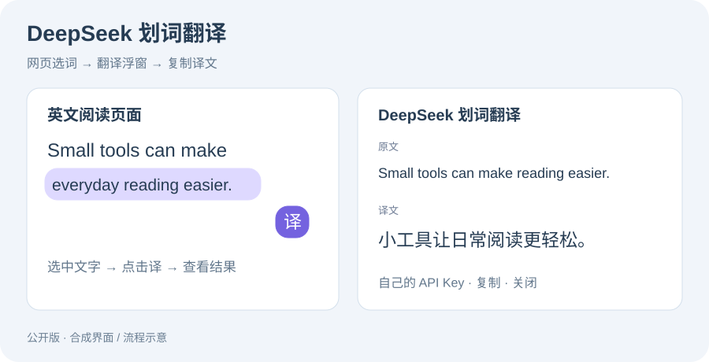

# DeepSeek 划词翻译

**在网页中选中文字，点击「译」，就地查看和复制翻译。** 使用自己的 DeepSeek API Key，支持目标语言设置和连接测试。



JavaScript · Chrome / Edge · Manifest V3 · Shadow DOM · DeepSeek API

## 使用

1. 下载仓库。在 Chrome / Edge 的扩展管理页打开「开发者模式」。
2. 点击「加载已解压的扩展程序」，选择 `extension/` 文件夹。
3. 打开扩展设置，填入自己的 API Key，保存并测试连接。
4. 刷新要翻译的网页，选中文字，点击浮动的「译」按钮。

不支持浏览器内部页面、扩展商店等浏览器禁止注入的页面。需要 Chrome / Edge 102+。API 请求按你的 DeepSeek 账号计费。

无需密钥的界面演示：下载后用浏览器打开 [demo/index.html](demo/index.html)。演示使用固定译文，只验证交互；扩展安装后才会调用真实 API。

## 实现与修复

- 保留原有的选词、浮窗、复制、设置和连接测试流程。
- 使用封闭 Shadow DOM，拒绝网页合成点击，避免网页脚本代替用户触发付费请求。
- 后台验证扩展来源、页面与请求编号；设置页测试不接受普通页面调用。
- 25 秒期限覆盖响应头与响应体；关闭浮窗取消本地请求。取消并不保证服务端未产生费用。
- 成功与失败均检查请求序号，旧错误不会覆盖新结果。
- 最多 3 个并发请求，每分钟最多 10 次；一分钟计数保存在浏览器会话存储中。失败后手动重试，避免自动重复计费。
- Key 仅保存在本机扩展存储，限制为扩展可信上下文访问；仅向 `https://api.deepseek.com` 发送。没有内置 Key。

## 检查

```sh
npm ci
npm test
```

测试使用 Node.js 24 和 JSDOM，覆盖合成点击、旧请求错误、响应体超时、取消、来源校验、错误信息和重启后的频率限制。网络响应为模拟数据，不消耗 API 额度。

公开版整理与检查日期：2026-10-12。已通过离线回归；真实 API 连通性仍取决于使用者的密钥、余额和网络。测试与界面示意不代表已完成浏览器商店审核。

## 项目来源

由日常英文阅读需求开发，使用 AI 辅助编码和调试；公开版对原实现做了权限、异步状态与超时修复。[作品集首页](https://github.com/WULUWA-233/computer-portfolio)。

参考：[Chrome Storage API](https://developer.chrome.com/docs/extensions/reference/api/storage)、[扩展 Service Worker 生命周期](https://developer.chrome.com/docs/extensions/develop/concepts/service-workers/lifecycle)、[DeepSeek API 文档](https://api-docs.deepseek.com/)。
